# Post-Interview Evaluation Bottleneck Report (Docker Jaeger Baseline)

**Environment:** Docker Compose (`qwen2.5:7b` on host Ollama, `http://localhost:16686` Jaeger)  
**Session Window:** `2026-11-21 22:48:28` – `22:56:19` (4 chat turns + 1 post-interview evaluation)

---

## 1. Executive Summary

* **Confirmed Bottleneck:** **99.39%** of `ai-service`'s evaluation latency (**1,067.24 ms** out of **1,073.79 ms**) and **98.89%** of `orchestrator`'s evaluation HTTP call (**1,079.21 ms**) is spent waiting on **Ollama `/api/chat`**.
* **Evaluation vs. Normal Chat Turn:**
  * **Total duration:** Evaluation (**1,079.21 ms**) is **2.11× slower** than the average chat turn (**512.67 ms**), and **2.25× slower** in Ollama alone (**1,067.24 ms** vs. **475.04 ms**).
  * **Perceived latency (TTFT vs. blocking JSON):** Chat turns stream tokens with an average **Time-to-First-Token (TTFT) of 148.00 ms**, whereas `evaluate-session` uses non-streaming JSON mode (`stream=False`) over the full transcript, blocking for the entire **1,079.21 ms** before returning any result.
* **Service & DB Overhead is Negligible:** Combined `orchestrator` + `ai-service` overhead is only **37.63 ms** on chat turns (PostgreSQL reads/writes + SSE framing) and **11.97 ms** on the evaluation HTTP call.

---

## 2. Raw Trace Measurements from Jaeger

### A. Normal Chat Message Stream (`POST /api/sessions/{id}/messages` → `POST /api/v1/generate-stream`)

| Turn | Timestamp | Trace ID | Orchestrator Total | AI Service Total | `ollama.chat.stream` (Full LLM) | `first_token` Event (TTFT) | `httpx` Headers Only |
|---:|---|---|---:|---:|---:|---:|---:|
| 1 | `22:48:28` | `08b35ac8ade7fa709288adaaedbe59c7` | 635.54 ms | 568.50 ms | 567.15 ms (99.8%) | 206.06 ms | 200.33 ms |
| 2 | `22:50:10` | `34f261ffac1c787b78acebece57c6103` | 450.50 ms | 424.09 ms | 423.20 ms (99.8%) | 131.37 ms | 125.75 ms |
| 3 | `22:51:42` | `fb31008ed631775f336896d78932cff1` | 531.09 ms | 505.08 ms | 504.11 ms (99.8%) | 158.37 ms | 152.19 ms |
| 4 | `22:56:19` | `29c4e0c51d82322762930487e57d9c01` | 433.54 ms | 406.56 ms | 405.68 ms (99.8%) | 96.18 ms | 90.31 ms |
| **Mean** | — | — | **512.67 ms** | **476.06 ms** | **475.04 ms (99.8%)** | **148.00 ms** | **142.15 ms** |

### B. Post-Interview Evaluation (`POST /api/v1/evaluate-session`)

| Timestamp | Trace ID | Orchestrator `WebClient` | AI Service Total | Ollama `/api/chat` (`stream=False`) | Non-Ollama Overhead |
|---|---|---:|---:|---:|---:|
| `22:56:19` | `99f6861eb12645c8fa1decc59dca39f4` | **1,079.21 ms** | **1,073.79 ms** | **1,067.24 ms (99.4%)** | **11.97 ms** |

---

## 3. Side-by-Side Comparison

```mermaid
xychart-beta
    title "Latency Breakdown: Mean Chat Turn vs. Final Evaluation (ms)"
    x-axis ["Chat Turn (Mean)", "Final Evaluation"]
    y-axis "Duration (ms)" 0 --> 1200
    bar [512.67, 1079.21]
    bar [475.04, 1067.24]
```

| Metric | Normal Chat Turn (Mean) | Final Evaluation | Ratio / Difference |
|---|---:|---:|---|
| **Orchestrator HTTP Duration** | 512.67 ms | 1,079.21 ms | **2.11×** slower |
| **AI Service Duration** | 476.06 ms | 1,073.79 ms | **2.26×** slower |
| **Ollama LLM Duration** | 475.04 ms | 1,067.24 ms | **2.25×** slower |
| **Ollama Share of AI Service** | 99.79% | 99.39% | Both are LLM-bound |
| **App/DB/Network Overhead** | 37.63 ms | 11.97 ms | Negligible |
| **Time Until User Sees Output** | **148.00 ms** (`first_token`) | **1,079.21 ms** (+ polling) | **7.29×** longer wait |

---

## 4. Root Cause Analysis

1. **Full-Transcript Prompt + Structured JSON Generation:**
   * A chat turn only generates a short conversational follow-up question and streams tokens immediately (`stream=True`).
   * `evaluate-session` sends the **entire interview conversation** plus resume metadata and asks Ollama (`format="json"`, `stream=False`) to synthesize all stage scores, strengths, improvements, and summary in a single blocking pass.
2. **Synchronous Wait at Interview End:**
   * All evaluation work happens *after* the final turn completes, putting **100% of the 1.08 s LLM cost** (and even more on longer 8–10 turn interviews) on the critical path of **Time-to-Scorecard**.
3. **Trace Context Detachment (Observability Note):**
   * `triggerAsyncEvaluation()` uses fire-and-forget `.subscribe()` on `Schedulers.boundedElastic()`, so `evaluate-session` appears in Jaeger as a standalone trace (`http post`) rather than nested under the final `/messages` or `/complete` span.

---

## 5. Next Step: How Day 9 (Kafka Incremental Evaluation) Addresses This

By publishing stage-completion events to **Kafka** as each interview stage (`INTRO`, `TECHNICAL`, `BEHAVIORAL`) finishes, the `ai-service` / evaluation worker can score earlier stages **in the background while the candidate is still in the next stage**. When the interview ends, only the final stage (or lightweight aggregation) remains, cutting post-interview **Time-to-Scorecard** significantly.
